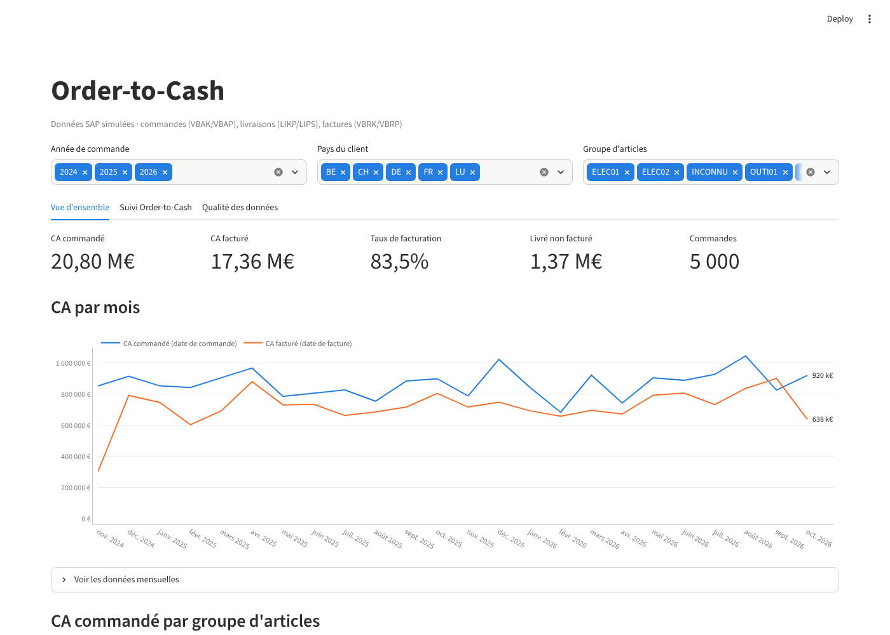

# Pipeline SAP Order-to-Cash


Projet d'autoformation : une pipeline data complète, de données SAP jusqu'à un tableau de bord, avec uniquement des outils gratuits.

## Objectif

Simuler une entreprise sous SAP et construire la chaîne :

```
Données SAP simulées (CSV)
  → Bronze : données brutes (Parquet / DuckDB)
  → Silver : données nettoyées (dbt)
  → Gold   : modèle en étoile (dbt)
  → Tableau de bord (Streamlit)
```

Le tout est automatisé avec GitHub Actions (exécution planifiée, tests de qualité, alertes).

## Tables SAP simulées

| Table | Contenu |
|---|---|
| KNA1 | Clients |
| MARA / MAKT | Articles et désignations |
| VBAK / VBAP | Commandes de vente (en-têtes / postes) |
| LIKP / LIPS | Livraisons (en-têtes / postes) |
| VBRK / VBRP | Factures (en-têtes / postes) |

## Stack

- Python (Faker, pandas, pyarrow)
- DuckDB
- dbt-core + dbt-duckdb
- Streamlit + Plotly
- GitHub Actions

## Installation

```bash
python -m venv .venv
# Windows
.venv\Scripts\activate
# macOS / Linux
source .venv/bin/activate

pip install -r requirements.txt
```

## Générer les données

```bash
python scripts/generate_sap_data.py                 # 5 000 commandes (par défaut)
python scripts/generate_sap_data.py --orders 50000  # plus de volume
```

Les CSV sont écrits dans `data/raw/` (non versionné : on les régénère à volonté).

Défauts de qualité injectés volontairement : doublons clients, villes manquantes,
articles inexistants dans MARA, commandes non livrées, livraisons non facturées,
dates de sortie vides (`00000000`), écarts entre en-tête et postes de commande.

## Charger la couche Bronze

```bash
python scripts/load_bronze.py
```

Les CSV sont copiés tels quels (toutes les colonnes en texte) dans :
- `data/bronze/*.parquet`
- la base `data/warehouse.duckdb`, schéma `bronze`

Deux colonnes techniques sont ajoutées : `_loaded_at` (date du chargement) et `_source_file`.

## Transformer avec dbt (Silver)

```bash
cd dbt
dbt debug    # vérifie la connexion à DuckDB
dbt build    # crée les modèles et lance les tests
```

Couche Silver (schéma `silver`) :

| Modèle | Source SAP | Ce qui est fait |
|---|---|---|
| stg_clients | KNA1 | Renommage, ville vide → NULL, repérage des doublons et client maître |
| stg_articles | MARA + MAKT | Désignation française, libellé du type d'article |
| stg_commandes_entetes | VBAK | Dates SAP → dates, montants → décimaux |
| stg_commandes_postes | VBAP | Clé commande-poste, indicateur de refus |
| stg_livraisons_entetes | LIKP | Date de sortie `00000000` → NULL |
| stg_livraisons_postes | LIPS | Lien vers le poste de commande |
| stg_factures_entetes | VBRK | Indicateur d'annulation |
| stg_factures_postes | VBRP | Liens vers la livraison et la commande |

Macros utiles : `sap_date()` (AAAAMMJJ → date) et `sap_flag()` ('X' → vrai).

## Modèle en étoile (Gold)

Schéma `gold`, prêt pour le tableau de bord :

```
              dim_date
                 │ date_commande
dim_client ── fait_ventes ── dim_article
  client_id      │           article_id
```

| Modèle | Contenu |
|---|---|
| fait_ventes | Une ligne par poste de commande : montants commandés et facturés, quantités livrées, délais, statut O2C |
| dim_client | Clients, avec `nom_client_maitre` pour fusionner les doublons |
| dim_article | Articles, plus une ligne `INCONNU` pour les articles absents de MARA |
| dim_date | Calendrier 2024-2027 |

Statuts : Facturé, Facturé partiellement, Livré non facturé, Non livré, Refusé.

## Qualité des données

```bash
cd dbt
dbt build              # modèles + tous les tests
dbt source freshness   # les données Bronze ont-elles été chargées récemment ?
```

| Test | Niveau | Vérifie |
|---|---|---|
| assert_reconciliation_bronze_gold | Bloquant | Même nombre de postes et même montant entre Bronze et Gold |
| assert_facture_sans_livraison | Bloquant | On ne facture pas plus que ce qui a été livré |
| valeur_positive (générique) | Bloquant | Montants et quantités jamais négatifs |
| assert_entete_commande_egale_somme_postes | Avertissement | VBAK.NETWR = somme des postes VBAP |
| assert_articles_orphelins | Avertissement | Articles absents de MARA |
| assert_livraisons_sans_date_sortie | Avertissement | Date de sortie des marchandises vide |

Les lignes en erreur sont enregistrées dans le schéma `audit` (une table par test).

## Tableau de bord (Streamlit)

```bash
python scripts/export_gold.py     # Gold + résumé qualité -> data/gold/*.parquet
streamlit run app/dashboard.py    # ouvre http://localhost:8501
```

Le tableau de bord lit les fichiers Parquet (pas la base DuckDB) : il peut rester ouvert pendant que dbt tourne.

| Onglet | Contenu |
|---|---|
| Vue d'ensemble | CA commandé / facturé, taux de facturation, CA par mois, CA par groupe d'articles |
| Suivi Order-to-Cash | Délais, montants par statut, top 10 clients « livré non facturé » (export CSV) |
| Qualité des données | Résultat des tests dbt, CA rattaché à des articles inconnus |



## Automatisation (GitHub Actions)

| Workflow | Déclenchement | Ce qu'il fait |
|---|---|---|
| `ci.yml` | Chaque pull request vers `main` | Reconstruit toute la chaîne, lance les tests dbt, vérifie que le tableau de bord démarre |
| `pipeline.yml` | Chaque nuit (01:17 UTC) + manuel | Extraction → Bronze → fraîcheur → dbt build → export Gold, puis sauvegarde des résultats (7 jours) |

Alertes en cas d'échec : e-mail automatique de GitHub, et message Discord si le secret `DISCORD_WEBHOOK_URL` est configuré.

## Avancement

- [x] 1. Mise en place du dépôt
- [x] 2. Génération des données SAP simulées
- [x] 3. Couche Bronze
- [x] 4. dbt + couche Silver
- [x] 5. Couche Gold
- [x] 6. Tests de qualité et réconciliation
- [x] 7. Tableau de bord
- [x] 8. Automatisation (GitHub Actions)
